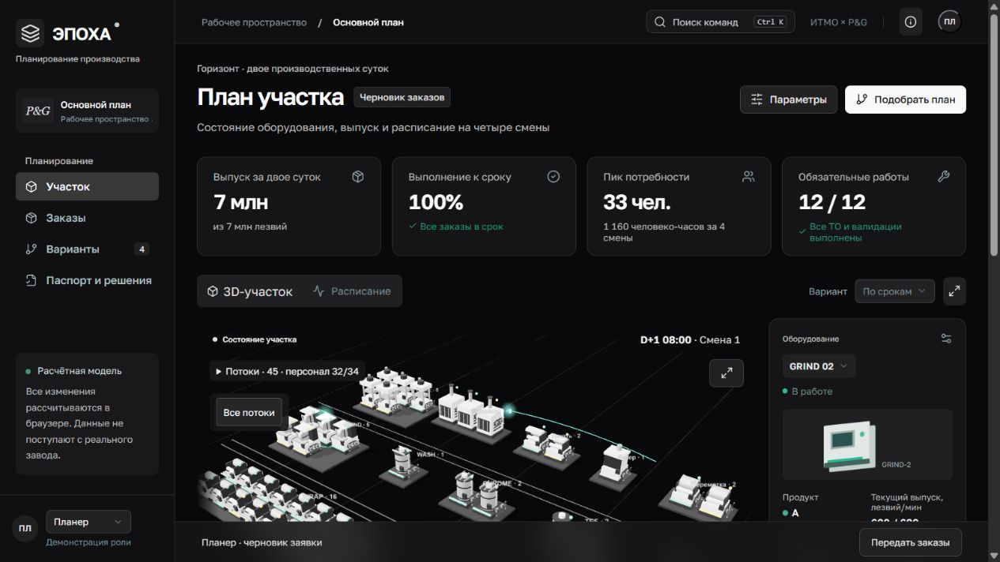

# ЭПОХА v1.3 — планировщик производства

React 19 + Vite + Three.js. Обычный подбор работает без сервера; для необязательного ИИ-помощника нужен локальный API-сервер и ключ провайдера. Интерфейс на русском. 3D-схема условная, расчёты соответствуют описанной ниже учебной модели.

## Сравнение с ИИ в v1.3

На третьей странице «Варианты» доступны два 3D-вида, общая шкала времени, общий выбор машины и переключение ракурса. Камеры можно вращать независимо. Ниже — разница выпуска за четыре смены, недопоставки к сроку, человеко-часов и переналадок, выпуск по продуктам к выбранному времени и готовность каждого заказа к дедлайну. Нулевые различия показываются честно.

**С ИИ / без ИИ:** слева лучший результат обычного поиска (до 12 комбинаций), справа лучший из базового результата и проверенных предложений языковой модели. Модель предлагает до 8 сочетаний стратегии, смещения ТО и самого раннего начала отдельных работ. Симулятор проверяет окна, материалы, людей и обязательные работы. Неизвестные работы, изменения начатого и недопустимые окна отклоняются. Штат, заказы, события, машины и исторические снимки модель менять не может. Если улучшения нет, справа сохраняется базовый план. Свободный текст задаёт пожелание модели; жёсткие ограничения задаются параметрами сценария, пользовательские пожелания не гарантируются и требуют проверки результата. Глобальная оптимальность не доказана.

**Обычный поиск — просмотр без ключа:** слева текущая стратегия, справа лучший обычный вариант. Это не ИИ и не имитация ответа модели. Работает и в автономном HTML.

### Подключение модели

1. Node.js 22.9+; скопируйте `.env.example` в `.env`.
2. Укажите `AI_API_KEY` и `AI_MODEL` — доступное вашему аккаунту имя модели с поддержкой JSON-ответов Chat Completions. При необходимости измените `AI_BASE_URL` на совместимый API.
3. В одном терминале запустите `pnpm ai:server`, в другом — `pnpm dev`.
4. Откройте `http://127.0.0.1:5173`, страницу «Варианты», задайте цель и нажмите «Подобрать с ИИ». Для другого origin измените `AI_ALLOWED_ORIGIN`. При занятом порте API обновите также proxy в `vite.config.js`.

Ключ хранится только в `.env` на сервере и исключён из git. Не используйте префикс `VITE_` для секретов. Вызов модели передаёт параметры сценария и цель настроенному провайдеру; отправка происходит по кнопке. Ответ модели не исполняется как код. Ошибка провайдера, неверный JSON или таймаут отображаются отдельно; обычный подбор остаётся доступен. После изменения входных данных результаты сравнения сбрасываются. Применение правого плана создаёт черновик, требующий повторного согласования.

Автономный файл и GitHub Pages не содержат секретного ключа и API-сервера. Настоящий ИИ доступен при локальном запуске или при отдельном развёртывании защищённого backend с `/api/ai`; публичную авторизацию и многопользовательский лимит запросов нужно добавить до общего развёртывания. Локальный сервер слушает только 127.0.0.1, ограничивает размер запроса, один активный вызов и время ожидания. Это прототип, не промышленный сервис.

Провайдерный запрос реализован по [документации Chat Completions](https://developers.openai.com/api/reference/resources/chat). Проверки адаптера используют тестовый ответ, не платный вызов реальной модели.



## Исправления v1.3

- Удалена страница «Логика модели», техническое описание оставлено в этом README.
- Прерванная валидация не засчитывается частями через другие продукты или потерю необходимого ресурса. Такой план получает конфликт и требует пересмотра.
- После событий можно переносить будущие ТО и валидации, в том числе выбирать машины. Начатые работы и выполненное прошлое защищены.
- В паспорт экспортируются все решения и связанные снимки версий: исходный план, ремонт, невыход и последующие изменения.
- Дубли расписаний удаляются; число расчётов показывается отдельно от числа уникальных вариантов.
- Цвета продуктов согласованы между графиком и 3D-потоками. Пилот доступен в паспорте, статусы показывают этап согласования.

## Автономная демоверсия

Скачайте [docs/index.html](docs/index.html) через кнопку Download raw file на GitHub и откройте файл в браузере. Файл содержит интерфейс, 3D-сцену и расчётный движок; установка зависимостей не требуется. Для 3D нужен браузер с WebGL.

[case-scenario.json](case-scenario.json) — пример исходных данных для загрузки через «Параметры → Загрузить JSON».

Папка `docs/` подготовлена для GitHub Pages, если владелец решит включить публикацию из `main /docs` в настройках репозитория. Загрузка файлов сама по себе не включает Pages.

## Запуск

Установить Node.js 22+ и pnpm, затем из этой папки:

```sh
pnpm install
pnpm dev
```

Открыть напечатанный локальный адрес. Для сборки: `pnpm build`. Для всех проверок: `pnpm test` (или `node --test tests/*.test.js`).

## Что попробовать

1. Выбрать машину на сцене или в списке, передвинуть время, запустить воспроизведение.
2. Открыть параметры: численность по сменам, объёмы заказов, размещение ТО.
3. Нажать «Подобрать план»: сравнить 12 комбинаций, применить вариант.
4. Последовательно применить поломку GRIND и невыход двух человек. Заявка на первые две смены фиксируется.
5. Посмотреть заказы, посменный паспорт, обязательные работы и конфликты.
6. Экспортировать JSON, восстановить кейс и загрузить параметры обратно.

## Движок

`src/engine.js` — чистый расчётный модуль. Единицы: лезвия, календарные минуты с D+1 08:00. Исходные заказы и остатки взяты из предоставленного кейса ИТМО × P&G.

- DAG задаёт маршруты А/Б/В и зависимости подачи. Узлы не требуют завершения всего заказа перед запуском следующей стадии: поток передаётся непрерывно.
- Ресурсные связи описывают порядок заказов на группах оборудования. Четыре эвристики × три смещения ТО дают до 12 расчётов; одинаковые расписания удаляются. Маршруты обрабатываются в топологическом порядке, граф служит описанием и проверкой порядка. Поиск ограниченный, без доказательства глобального оптимума.
- Эпохи заканчиваются на событии: граница календаря, окончание наладки/ТО/валидации, исчерпание запаса, достижение цели выпуска, поломка.
- На эпохе рассчитываются скорости потоков в топологическом порядке. Подача ограничивает последующие этапы, балансы неотрицательны. Начальные остатки уменьшают потребность в предыдущих этапах.
- Каждая группа оборудования следует очереди заказов выбранного варианта. Операторы распределяются от последующих операций к предыдущим; групповая норма округляется вверх. Оператор назначенной машины может ожидать подачу; это консервативный расход персонала.
- ТО/ремонт освобождает штатного оператора. Валидация добавляет одного работника на машину и идёт одновременно с выпуском нужного продукта. Обычная переналадка не создаёт новую валидацию. Начатая проверка может прерываться общим календарём, но не сменой продукта или потерей требуемого ресурса. Её остаток не накапливается в другой кампании.
- Ремонт GRIND-2 длится 10:00–13:00, 180 календарных / 150 рабочих минут и не заменяет ТО-2.
- Первые две смены фиксируются до 12:00 дня D, вторые две — прогноз. Невыход уменьшает фактический штат ночной смены на два, добавление людей после фиксации запрещено интерфейсом.
- При последовательных событиях снимки стратегий и назначений сохраняют решения до события. Будущие работы меняются только с момента события. Начатую работу нельзя перенести задним числом. Исторические объёмы заказов после запуска событий редактировать нельзя.
- Подбор работает в Web Worker, не блокируя 3D-интерфейс. Программа отображает фактическую длительность расчёта. <5 мс — цель дальнейшей оптимизации, не гарантированная характеристика.
- Альтернатива time-expanded network в прототип не включена: событийная модель не требует развёртки всей временной сетки.

## Файлы

- `src/engine.js`: модель, календарь, DAG, событийный симулятор, подбор.
- `src/optimizer.worker.js`: подбор вариантов в отдельном потоке браузера.
- `src/Factory.jsx`: 3D-оборудование, подсветка и выбор машин.
- `src/main.jsx`: управление сценарием, расписание, паспорт, согласование.
- `src/versions.js`: связанные неизменяемые снимки версий и полная история решений.
- `tests/v13.test.js`: регрессии непрерывности валидаций, переноса будущих работ, защиты прошлого и экспорта истории.
- `tests/engine.test.js`: баланс, календарь, работы, люди, последовательные события, некорректный импорт.

## Ограничения

Это фронтенд-прототип. Локальные роли и согласование демонстрируют процесс, а не реализуют многопользовательский доступ. Согласованная версия и параметры сохраняются в localStorage браузера. Серверного аудита и авторизации нет. При изменениях план становится черновиком.

Деньги не рассчитываются без ставок. Выведены человеко-часы и минуты оборудования. Импорт/экспорт реализован в JSON, Excel/CSV пока не подключён. Сценарий с изменёнными объёмами является экспериментом, не неизменённым сценарием кейса.

Согласование блокируется при незавершённых обязательных работах. Просрочки заказов показываются отдельно и могут потребовать согласования последствий. Импорт проверяет структуру, диапазоны и единицы. Исходные скорости, маршруты, коэффициент и правила обслуживания не редактируются.

## Подходы

Базовые ограничения производственного расписания: https://developers.google.com/optimization/scheduling/job_shop . Здесь используется эвристический событийный движок, OR-Tools не подключён.

### Проверка полного сценария в автономной версии

1. Выберите роль планера. В «Заказах» проверьте объёмы, сроки и приоритеты, затем передайте заказы.
2. В роли начальника участка откройте параметры. Назначьте машину ТО и самое раннее начало каждой работы, проверьте штат, внесите обоснование резерва и зафиксируйте заявку D+1.
3. Подберите варианты. В «Паспорте и решениях» сверьте интервалы работ, одновременную занятость на пике и выпуск к срокам. Передайте выбранный план планеру. Он может согласовать его или вернуть с замечанием.
4. На «Участке» последовательно примените ремонт и невыход. Сравните результат с предыдущим планом, пересмотрите стратегию и согласуйте изменения. Фактические сроки и объёмы при этом не подменяют исходные обязательства.
5. Выгрузите паспорт JSON. В нём сохраняются параметры, результаты по заказам и сменам, интервалы работ и полная цепочка решений со снимками версий. Журнал доступен в этом браузере.

Для обновления автономной страницы после правок выполните `pnpm build`, затем `pnpm build:demo`. В автономном режиме при недоступном Web Worker подбор использует тот же алгоритм в основном потоке.
